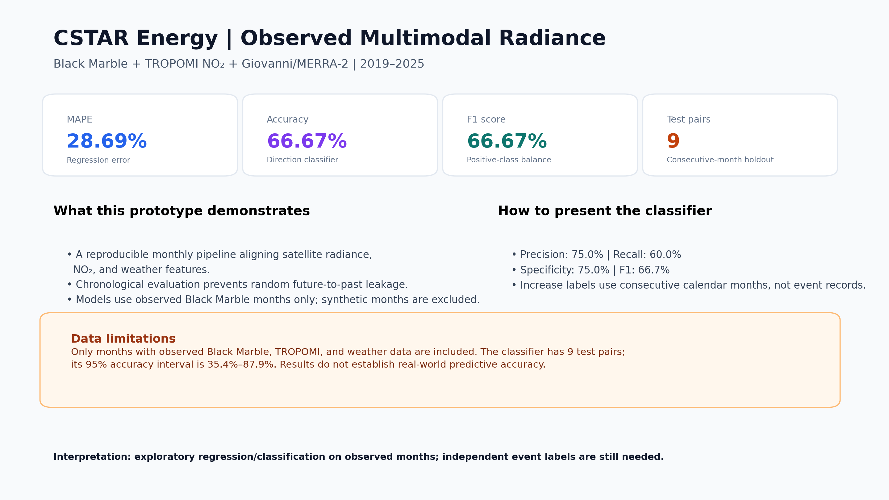

# CSTAR-ENERGY

Multi-satellite research workspace for monitoring nighttime radiance transitions in the Bicol Region of the Philippines.

The project combines quality-screened NASA Black Marble observations with TROPOMI NO2 and Giovanni/MERRA-2 weather features. The active React dashboard reads generated Black Marble map layers and evaluation artifacts from this repository; it does not use fabricated event records.

## Contents

- [Current results](#current-results)
- [Run the dashboard](#run-the-dashboard)
- [Process Black Marble data](#process-black-marble-data)
- [Train the models](#train-the-models)
- [Repository structure](#repository-structure)
- [Scientific limitations](#scientific-limitations)

## Current results

The repository contains two different experiments. Their metrics are reported separately because they use different targets, features, and test sets.

### 1. Spatial Black Marble Random Forest

This model predicts one-calendar-month-ahead cell radiance and its direction from quality-screened VNP46A3 observations. The chronological holdout covers September 2024 through October 2026.

| Metric | Holdout result |
| --- | ---: |
| Accuracy | **71.89%** |
| Balanced accuracy | **67.28%** |
| Precision | **17.80%** |
| Recall | **61.70%** |
| F1 score | **27.63%** |
| ROC AUC | **0.750** |
| Radiance MAE | **0.1168** |
| Radiance RMSE | **0.3714** |

Evaluation size: **180,000 cell-month samples** across **15 held-out month pairs**. The low positive-class precision shows that the direction classifier still produces many false positives; accuracy alone should not be used to judge this model.

Source: [spatial_metrics.json](models/evaluation/blackmarble/spatial_metrics.json)

### 2. Observed multimodal prototype

This experiment aligns observed Black Marble radiance, Bicol-cropped TROPOMI NO2, and monthly Giovanni/MERRA-2 weather data from January 2019 through December 2025. Presentation-only and synthetic radiance rows are excluded.

#### Direction classification

| Metric | Holdout result |
| --- | ---: |
| Accuracy | **66.67%** |
| Balanced accuracy | **67.50%** |
| Precision | **75.00%** |
| Recall | **60.00%** |
| Specificity | **75.00%** |
| F1 score | **66.67%** |
| ROC AUC | **0.800** |
| Accuracy 95% Wilson interval | **35.42%-87.94%** |

The classification holdout contains only **9 consecutive-month pairs** (`TN=3`, `FP=1`, `FN=2`, `TP=3`). The wide confidence interval is therefore important context for the point estimate.

#### Radiance regression

| Metric | Model | Persistence baseline |
| --- | ---: | ---: |
| MAE | **0.0539** | 0.0612 |
| RMSE | **0.0683** | 0.0772 |
| MAPE | **28.69%** | 40.06% |

The regression holdout contains **14 monthly rows**. Candidate selection chose Gradient Boosting for regression and Random Forest for classification using expanding-window time-series validation.



## Run the dashboard

The browser application is in `frontend/` and uses React, TypeScript, and Vite.

```powershell
cd frontend
npm.cmd install
npm.cmd run dev
```

Open the URL printed by Vite, normally `http://localhost:5173`. On macOS or Linux, use `npm` instead of `npm.cmd`.

Run the frontend checks with:

```powershell
npm.cmd run typecheck
npm.cmd test
npm.cmd run test:ui
npm.cmd run build
```

See the [frontend documentation](frontend/README.md) for the available views and data contracts.

## Process Black Marble data

The `modules/radiance/` package inventories and processes NASA Black Marble VNP46A3 Collection 2 monthly composites. The current study area is the Bicol Region, approximated by bounding box `122.3, 11.4, 124.7, 14.6` within tile `h30v07`.

Primary radiance statistics retain:

- `AllAngle_Composite_Snow_Free` radiance;
- mandatory quality value `0`;
- pixels with an observation count greater than zero; and
- land and coastal pixels.

Poor-quality and gap-filled pixels are recorded for provenance but excluded from the primary statistics.

Inventory the official NASA LAADS archive without downloading files:

```powershell
python -m modules.radiance.download --start-year 2016 --end-year 2026 --list-only
```

After configuring `NASA_EARTHDATA_TOKEN` in the current shell, download the selected files:

```powershell
python -m modules.radiance.download --start-year 2016 --end-year 2026
```

Process the local HDF5 inputs:

```powershell
python -m modules.radiance.analysis --input BlackMarbles
```

The processor writes a time-series CSV and provenance manifest under `data/processed/radiance/`. Raw HDF5 inputs are intentionally excluded from Git.

## Train the models

### Spatial Black Marble model

Regenerate the fitted Random Forest, evaluation metrics, and compressed dashboard grids from genuine VNP46A3 inputs:

```powershell
python -m experiments.blackmarble_spatial_forecast --input BlackMarbles
```

Outputs are written to:

- `models/training/blackmarble/` for fitted model artifacts;
- `models/evaluation/blackmarble/` for metrics and charts; and
- `frontend/public/data/blackmarble/` for map-ready observed and forecast grids.

### Multimodal prototype

Train the observed-data multimodal experiment:

```powershell
python experiments/radiance_multimodal_demo.py
```

The script joins observed Black Marble, TROPOMI NO2, and Giovanni/MERRA-2 features. It uses chronological evaluation, excludes irregular month-to-month classification pairs, and writes finalized pipelines as joblib files under `models/training/blackmarble/`. XGBoost is considered when the optional dependency is available; otherwise the script uses the installed scikit-learn candidates.

### Repository tests

```powershell
python -m pytest
```

## Repository structure

| Path | Purpose |
| --- | --- |
| `frontend/` | Dataset-driven React dashboard and frontend tests |
| `backend/` | API, database, jobs, and service structure |
| `modules/radiance/` | Black Marble inventory, download, quality control, and processing |
| `experiments/` | Reproducible baseline, spatial, and multimodal training scripts |
| `data/` | Raw, interim, processed, and exported research data |
| `models/training/` | Serialized fitted model artifacts |
| `models/evaluation/` | Evaluation metrics and presentation charts |
| `pipeline/` | Satellite ingestion, harmonization, and analysis components |
| `tests/` | Repository-level unit, integration, and data-quality tests |

Backend configuration and endpoints are documented in [backend/README.md](backend/README.md).

## Scientific limitations

- Available Black Marble observations cover 2016-2026 but are irregular across months, which can introduce seasonal bias.
- VNP46A3 is a monthly composite product, not daily VNP46A2 data.
- Increase/decrease labels describe radiance direction between consecutive observed months; they are not independently verified lighting-transition events.
- The multimodal holdouts are small. Their metrics are exploratory and are not evidence of production performance.
- Forecast probabilities are not calibrated, and neither experiment establishes causal energy savings or intervention effectiveness.
- Accuracy must be interpreted together with balanced accuracy, precision, recall, specificity, F1, ROC AUC, and the reported confidence interval.

## Presentation-only monthly series

For interface mockups, a complete January 2016 through December 2026 series can be generated with:

```powershell
python -m modules.radiance.demo
```

Filled months are explicitly labeled `synthetic_demo`. They must not be used for training, evaluation, accuracy claims, or scientific inference. The training scripts exclude these rows.

## Security

Never commit or share NASA Earthdata tokens, `.env` files, credentials, or private download URLs. If a token has been exposed in a screenshot, terminal log, or chat, revoke it and generate a new one.
